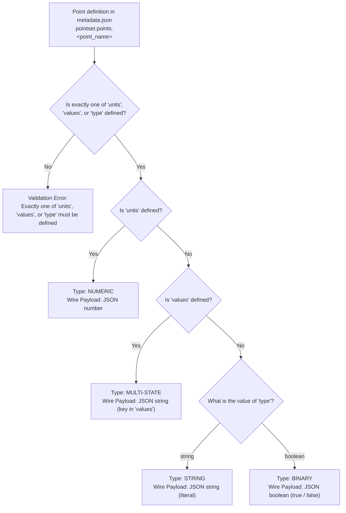

[**UDMI**](../../) / [**Docs**](../) / [**Specs**](./) / [Point Typing](#)

# Point Typing Specification

This specification defines how UDMI classifies telemetry and control points into **Numeric**, **Multi-state**, **String**, and **Binary** types based on the device's site model ([`metadata.json`](metadata.md)), and how that classification governs the JSON payload structure of [`pointset`](../messages/pointset.md) messages (`events`, `config`, and `state`).

---

## 1. Overview and Classification Rules

Every point declared under `pointset.points.<point_name>` in a device's `metadata.json` is deterministically classified into one of four mutually exclusive point types—**Numeric**, **Multi-state**, **String**, or **Binary**—based on the mutually exclusive `units`, `values`, and `type` fields:

| Point Type | Site Model Condition (`pointset.points.<point_name>`) | Wire JSON Type (`present_value` & `set_value`) | Valid Payload Examples | Invalid Payload Examples |
| :--- | :--- | :--- | :--- | :--- |
| **Numeric** | `units` is defined; `values` and `type` are omitted | `number` (integer or floating-point) | `21.5`, `100`, `0`, `-4.2` | `"21.5"`, `true`, `"HIGH"` |
| **Multi-state** | `values` is defined; `units` and `type` are omitted | `string` (raw value key in `values`) | `"0.0"`, `"1.0"`, `"1"`, `"2"` | `0`, `1.0`, `true`, `"OFF"`, `"OCCUPIED"` |
| **String** | `type` is `"string"`; `units` and `values` are omitted | `string` (arbitrary string literal) | `"v2.4.1"`, `"NONE"`, `"A1-04"` | `21.5`, `100`, `true`, `false` |
| **Binary** | `type` is `"boolean"`; `units` and `values` are omitted | `boolean` (`true` or `false`) | `true`, `false` | `0`, `1`, `"true"`, `"ON"` |
| *Invalid* | Two or more of `units`, `values`, and `type` are defined, or all three are omitted | *Validation Error* | N/A | N/A |



### Mutual Exclusivity and Model Constraints

1. **Exact-One Requirement (Mutual Exclusivity)**: Every point definition in `metadata.json` MUST specify **at most one** and **at least one** of `units`, `values`, or `type`. Specifying two or more of these fields—or omitting all three—is a site model validation error.
2. **Field Definitions**:
   * When `units` is present, it MUST be a non-empty string designating the unit of measure (or an explicit dimensionless unit designator such as `"no-units"`).
   * When `values` is present, it MUST be a non-empty object mapping at least two raw device values to canonical state strings.
   * When `type` is present, it MUST be set to either `"string"` (designating a **String** point) or `"boolean"` (designating a **Binary** point).

---

## 2. Type Specifications

### 2.1 Numeric Points (`units` Defined)

A point is **Numeric** when `pointset.points.<point_name>.units` is present and both `values` and `type` are absent.

#### Site Model (`metadata.json`)
* **`units`** *(required for Numeric)*: Specifies the canonical unit of measure expected for the point (e.g., `"degrees-celsius"`, `"percent"`, `"kilowatts"`, `"liters_per_second"`).
* **Dimensionless Numeric Quantities**: Points that represent numerical counts, ratios, or other dimensionless numbers (such as request counts, cycle counts, or power factor) MUST still define `units` using the dimensionless designator `"no-units"` (or `"No-units"`).
* **`units_reported`** *(optional)*: Specifies the raw unit string reported by the underlying device if it differs from the canonical `units` string.
* **Numeric Constraints** *(optional)*: `baseline_value` (must be a JSON `number`), `baseline_tolerance`, `range_min`, `range_max`, and `cov_increment` apply exclusively to Numeric points. `values` and `type` MUST NOT be set.

#### Wire Payloads
* **Telemetry (`events_pointset`)**:
  * `points.<point_name>.present_value` MUST be serialized as a native JSON `number` (integer or floating-point, e.g., `21.5` or `4`).
  * Whole-number quantities (such as integer counters) should be serialized without a fractional decimal part (e.g., `4`), and continuous measurements as floating-point numbers (e.g., `21.5`).
  * Serializing a numeric reading as a quoted string (e.g., `"21.5"`) or boolean is a validation error.
* **Configuration & Writeback (`config_pointset`)**:
  * `pointset.points.<point_name>.units` communicates the operating unit to the client.
  * When writeback is active, `pointset.points.<point_name>.set_value` MUST be a JSON `number`. If a non-numeric `set_value` or a value outside the device's valid operating bounds is received, the client MUST reject the writeback and report `value_state: "invalid"` in `state.pointset.points.<point_name>`.

---

### 2.2 Multi-state Points (`values` Defined)

A point is **Multi-state** when `pointset.points.<point_name>.values` is present and both `units` and `type` are absent.

#### Site Model (`metadata.json`)
* **`values`** *(required for Multi-state)*: A JSON object mapping each underlying raw device value (the object key, formatted as a string such as `"0.0"`, `"1.0"`, `"1"`, `"2"`) to its canonical ontology state label (the string value, formatted as an uppercase string such as `"OFF"`, `"ON"`, `"ACTIVE"`, `"INACTIVE"`, `"OCCUPIED"`, `"UNOCCUPIED"`, `"STANDBY"`):
  ```json
  "values": {
    "1": "OCCUPIED",
    "2": "UNOCCUPIED",
    "3": "STANDBY"
  }
  ```
  If multiple raw device values correspond to the same canonical state, each raw value is listed as its own key mapping to that canonical state string:
  ```json
  "values": {
    "0.0": "OFF",
    "1.0": "ON",
    "2.0": "ON"
  }
  ```
* **Two-State Enumerations**: Any point that defines `values` is classified as **Multi-state**, even when `values` has only two entries (for example, `{"0.0": "OFF", "1.0": "ON"}` or `{"1.0": "ACTIVE", "0.0": "INACTIVE"}`). Because a `values` map is declared, the point's wire representation is a JSON `string` matching one of the raw value keys (left side) in `values` (e.g., `"0.0"`, `"1.0"`), not a JSON `boolean` (`true`, `false`) or the translated state label (`"OFF"`, `"ON"`).
* **Constraints**: `baseline_value`, when present on a Multi-state point, MUST be a JSON `string` matching one of the raw value keys (left side) in `values`. Numeric-only fields (`units`, `units_reported`, `range_min`, `range_max`, `baseline_tolerance`, `cov_increment`) and `type` MUST NOT be set on a Multi-state point.

#### Wire Payloads
* **Telemetry (`events_pointset`)**:
  * `points.<point_name>.present_value` MUST be serialized as a JSON `string` that matches one of the raw value keys (left side) defined in `values` (e.g., `"1"`, `"1.0"`).
  * Unquoted numbers (e.g., `1`, `1.0`), boolean values (`true`, `false`), or the translated canonical state labels from the right side of `values` (e.g., `"OCCUPIED"`, `"ON"`) MUST NOT be emitted as `present_value`.
  * If the underlying hardware reports a raw value that does not match any key in `values`, the client MUST omit `present_value` for that point (or mark the point invalid) and populate `state.pointset.points.<point_name>.status` with an error entry.
* **Configuration & Writeback (`config_pointset`)**:
  * When writeback is active, `pointset.points.<point_name>.set_value` MUST be a JSON `string` matching one of the raw value keys (left side) in `values` (e.g., `"1.0"`, `"1"`).
  * If `set_value` is not a string or does not match any raw value key in `values`, the client MUST reject the writeback and set `state.pointset.points.<point_name>.value_state` to `"invalid"`.

---

### 2.3 String Points (`type: "string"`)

A point is **String** when `pointset.points.<point_name>.type` is set to `"string"` and both `units` and `values` are absent.

#### Site Model (`metadata.json`)
* **`type`** *(required for String)*: MUST be set to `"string"`:
  ```json
  "active_fault_code": {
    "type": "string",
    "ref": "characterstring_value_1",
    "baseline_value": "NONE"
  }
  ```
* **Constraints**: If `baseline_value` is specified for a String point, it MUST be a JSON `string`. Numeric-only fields (`units`, `units_reported`, `range_min`, `range_max`, `baseline_tolerance`, `cov_increment`) and `values` MUST NOT be set on a String point.

#### Wire Payloads
* **Telemetry (`events_pointset`)**:
  * `points.<point_name>.present_value` MUST be serialized as a JSON `string` literal (e.g., `"NONE"`, `"v2.4.1"`).
  * Unquoted numbers (e.g., `21.5`, `100`) and boolean values (`true`, `false`) MUST NOT be emitted as `present_value`.
* **Configuration & Writeback (`config_pointset`)**:
  * When writeback is active, `pointset.points.<point_name>.set_value` MUST be a JSON `string`.
  * If `set_value` is any type other than `string`, the client MUST reject the writeback and report `value_state: "invalid"` in `state.pointset.points.<point_name>`.

---

### 2.4 Binary Points (`type: "boolean"`)

A point is **Binary** when `pointset.points.<point_name>.type` is set to `"boolean"` and both `units` and `values` are absent.

#### Site Model (`metadata.json`)
* **`type`** *(required for Binary)*: MUST be set to `"boolean"`:
  ```json
  "filter_alarm_pressure_status": {
    "type": "boolean",
    "ref": "binary_input_11",
    "baseline_value": false
  }
  ```
* Standard non-typing metadata properties (`ref`, `writable`, `baseline_value`, `baseline_state`, `description`, `tags`, `expr`) may also be present.
* **Constraints**: If `baseline_value` is specified for a Binary point, it MUST be a JSON `boolean` (`true` or `false`). Numeric-only fields (`units`, `units_reported`, `range_min`, `range_max`, `baseline_tolerance`, `cov_increment`) and `values` MUST NOT be set.

#### Wire Payloads
* **Telemetry (`events_pointset`)**:
  * `points.<point_name>.present_value` MUST be serialized as a JSON `boolean` literal (`true` or `false`).
  * Numeric representations (`0`, `1`) and string literals (`"true"`, `"false"`, `"ON"`, `"OFF"`) are invalid for Binary points.
* **Configuration & Writeback (`config_pointset`)**:
  * When writeback is active, `pointset.points.<point_name>.set_value` MUST be a JSON `boolean` (`true` or `false`).
  * If `set_value` is any type other than `boolean`, the client MUST reject the writeback and report `value_state: "invalid"` in `state.pointset.points.<point_name>`.

---

## 3. End-to-End Example

### 3.1 Site Model Definition (`devices/AHU-1/metadata.json`)

The following `pointset` block in `metadata.json` illustrates all four point types—including a continuous Numeric sensor, a dimensionless Numeric counter, a two-state Multi-state command, a four-state Multi-state mode, a String literal point, and two Binary status/command points:

```json
{
  "version": "1.5.7",
  "timestamp": "2026-01-01T00:00:00Z",
  "pointset": {
    "points": {
      "supply_air_temperature_sensor": {
        "units": "degrees-celsius",
        "ref": "analog_input_1",
        "baseline_value": 21.5,
        "baseline_tolerance": 2.0
      },
      "cooling_request_count": {
        "units": "no-units",
        "ref": "analog_value_4"
      },
      "supply_fan_run_command": {
        "writable": true,
        "ref": "digital_output_2",
        "values": {
          "0.0": "OFF",
          "1.0": "ON"
        },
        "baseline_value": "1.0"
      },
      "occupancy_mode": {
        "writable": true,
        "ref": "multistate_value_1",
        "values": {
          "1": "OCCUPIED",
          "2": "UNOCCUPIED",
          "3": "STANDBY",
          "4": "BYPASS"
        },
        "baseline_value": "1"
      },
      "active_fault_code": {
        "type": "string",
        "ref": "characterstring_value_1",
        "baseline_value": "NONE"
      },
      "filter_alarm_pressure_status": {
        "type": "boolean",
        "ref": "binary_input_11",
        "baseline_value": false
      },
      "damper_isolation_enable": {
        "type": "boolean",
        "writable": true,
        "ref": "binary_output_5",
        "baseline_value": true
      }
    }
  }
}
```

### 3.2 Resulting Config Message (`config` -> `pointset`)

When the cloud configures the device (including writeback `set_value` entries derived from `baseline_value` for writable points), the generated `config.pointset` block is:

```json
{
  "sample_rate_sec": 300,
  "points": {
    "supply_air_temperature_sensor": {
      "ref": "analog_input_1",
      "units": "degrees-celsius"
    },
    "cooling_request_count": {
      "ref": "analog_value_4",
      "units": "no-units"
    },
    "supply_fan_run_command": {
      "ref": "digital_output_2",
      "set_value": "1.0"
    },
    "occupancy_mode": {
      "ref": "multistate_value_1",
      "set_value": "1"
    },
    "active_fault_code": {
      "ref": "characterstring_value_1"
    },
    "filter_alarm_pressure_status": {
      "ref": "binary_input_11"
    },
    "damper_isolation_enable": {
      "ref": "binary_output_5",
      "set_value": true
    }
  }
}
```

### 3.3 Resulting Pointset Event Payload (`events/pointset`)

The client publishes the corresponding `events/pointset` telemetry message with each point's `present_value` formatted according to its resolved type:

```json
{
  "version": "1.5.7",
  "timestamp": "2026-01-01T00:05:00Z",
  "points": {
    "supply_air_temperature_sensor": {
      "present_value": 21.4
    },
    "cooling_request_count": {
      "present_value": 3
    },
    "supply_fan_run_command": {
      "present_value": "1.0"
    },
    "occupancy_mode": {
      "present_value": "1"
    },
    "active_fault_code": {
      "present_value": "NONE"
    },
    "filter_alarm_pressure_status": {
      "present_value": false
    },
    "damper_isolation_enable": {
      "present_value": true
    }
  }
}
```
